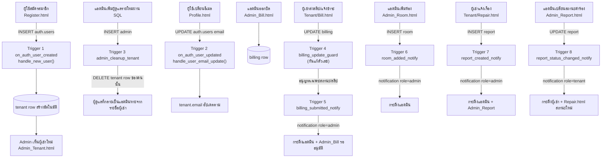

# รายงาน Trigger ของระบบหอพักเพชร (Phet-Dorm-V2)

> เอกสารนี้อธิบาย **Trigger** ทั้งหมดของระบบ (เฉพาะที่แอปสร้างขึ้นเอง) กลไกการทำงาน ผลกระทบต่อหน้าจอ และขั้นตอนการถ่ายภาพ Capture เพื่อเป็นหลักฐานการทำงานของแต่ละ trigger
>
> ข้อมูลอ้างอิงจาก: `pg_get_triggerdef()` บนฐานข้อมูลจริง (live DB) + ไฟล์ migrations ใน `supabase/migrations/`

---

## 1. บทนำ

ระบบมี **Trigger ที่สร้างเอง 8 ตัว** แบ่งเป็น 2 กลุ่ม

| กลุ่ม | จำนวน | หน้าที่ |
|---|---|---|
| **ระบบบัญชีผู้ใช้** (Account) | 3 | สร้าง/อัปเดตผู้เช่าจาก `auth.users` และล้างแถวผู้เช่าเมื่อกลายเป็นผู้ดูแล |
| **ระบบแจ้งเตือน + กันแก้บิล** (Notification / Guard) | 5 | สร้างข้อความแจ้งเตือนอัตโนมัติ และกันผู้เช่าแก้ไขตัวเลขบิล |

> **หมายเหตุ:** ไม่นับ trigger แบบ Built-in ของ Supabase เช่น `storage.*` (กันลบ bucket/objects) และ `realtime.subscription_tr_check_filters` เนื่องจากเป็นกลไกของ platform ไม่ใช่ของแอป

ทุก trigger ใช้ฟังก์ชัน `security definer set search_path = public` เพื่อให้ทำงานในนามเจ้าของตารางแม้ถูกเรียกโดย client ที่มี RLS จำกัด

---

## 2. ตารางสรุป Trigger ทั้งหมด

| # | ชื่อ Trigger | ตาราง | จังหวะ | เหตุการณ์ที่ทำงาน | ฟังก์ชัน | หน้าจอที่เกี่ยวข้อง |
|---|---|---|---|---|---|---|
| 1 | `on_auth_user_created` | `auth.users` | AFTER | INSERT | `handle_new_user()` | Register, Admin_Tenant |
| 2 | `on_auth_user_updated` | `auth.users` | AFTER | UPDATE OF email | `handle_user_email_update()` | Profile (Login), Admin_Tenant |
| 3 | `admin_cleanup_tenant` | `public.admin` | AFTER | INSERT / UPDATE OF user_id | `admin_cleanup_tenant()` | Admin_Tenant, Profile |
| 4 | `billing_update_guard` | `public.billing` | BEFORE | UPDATE | `guard_billing_update()` | Tenant/Bill |
| 5 | `billing_submitted_notify` | `public.billing` | AFTER | UPDATE โดยให้ `bill_status` → `รออนุมัติการชำระเงิน` | `notify_on_billing_submitted()` | Tenant/Bill, Admin_Bill, กระดิ่ง admin |
| 6 | `room_added_notify` | `public.room` | AFTER | INSERT | `notify_on_room_added()` | Admin_Room, กระดิ่ง admin |
| 7 | `report_created_notify` | `public.report` | AFTER | INSERT | `notify_on_report_created()` | Tenant/Repair, Admin_Report, กระดิ่ง admin |
| 8 | `report_status_changed_notify` | `public.report` | AFTER | UPDATE สถานะ ≠ `ยังไม่ได้รับเรื่อง` | `notify_on_report_status_changed()` | Admin_Report, Tenant/Repair, กระดิ่งผู้เช่า |

---

## 3. รายละเอียด Trigger ทีละตัว

### 3.1 `on_auth_user_created` — สร้างบัญชีผู้เช่าอัตโนมัติตอนสมัคร

**Trigger:** `on_auth_user_created`

**ตาราง:** `auth.users`

**จังหวะ/เหตุการณ์:** `AFTER INSERT` — ทำงานเมื่อมีบัญชีใหม่ INSERT เข้า `auth.users` (ผู้ใช้สมัครสมาชิก)

**ใช้ทำอะไร:** สร้างแถว `tenant` ให้อัตโนมัติ เพื่อให้ผู้เช่ามีแถวประจำตัวในระบบตั้งแต่แรก (ผู้เช่า = ตาราง `tenant` เป็นแหล่งเดียว)

**ขั้นตอนในฟังก์ชัน:**
1. อ่าน `phone_number` และ `full_name` จาก `raw_user_meta_data`
2. ตรวจเบอร์โทรต้องเป็น `^0[0-9]{9}$` (เลข 10 หลักขึ้นต้น 0) — ไม่งั้น `raise` เลิก สมัครไม่ได้
3. `insert into tenant (user_id, email, full_name, phone_number, password='', room_number=NULL)` และ `on conflict do nothing`

**ผลกระทบ:** แอดมินเห็นผู้เช่าใหม่ในหน้าจัดการผู้เช่าทันที โดยไม่ต้องกรอกซ้ำ

```sql
create trigger on_auth_user_created
  after insert on auth.users
  for each row execute function public.handle_new_user();
```

**หน้าจอที่เกี่ยวข้อง:**

| ภาพ | หน้าจอ | สิ่งที่เห็น |
|---|---|---|
|  | `Login/Register.html` | ฟอร์มสมัครที่ฝ่ายผู้เช่ากรอกข้อมูล |
|  | `Admin/Admin_Tenant.html` | ผู้เช่ารายใหม่ปรากฏในรายชื่อ (ยังไม่มีห้อง) |

**การ Capture:** เปิดหน้า Register สมัครบัญชีทดสอบ (โหมด dev) → เปิดหน้า Admin_Tenant ให้เห็นผู้เช่ารายใหม่ที่เพิ่งสมัครอยู่แถวบนของรายชื่อ

---

### 3.2 `on_auth_user_updated` — อัปเดตอีเมลผู้เช่าตาม auth

**Trigger:** `on_auth_user_updated`

**ตาราง:** `auth.users`

**จังหวะ/เหตุการณ์:** `AFTER UPDATE OF email` — ทำงานเมื่อผู้ใช้อัปเดตคอลัมน์ `email` ใน `auth.users`

**ใช้ทำอะไร:** ซิงก์อีเมลใหม่ให้แถว `tenant` ของคนนั้นตามไปด้วย (ตาราง `admin` ไม่มีคอลัมน์ email เพราะอีเมลแอดมินอยู่ที่ `auth.users`)

```sql
create trigger on_auth_user_updated
  after update of email on auth.users
  for each row execute function public.handle_user_email_update();
```

**หน้าจอที่เกี่ยวข้อง:**

| ภาพ | หน้าจอ | สิ่งที่เห็น |
|---|---|---|
|  | `Login/Profile.html` | ฟอร์มแก้ไขข้อมูลส่วนตัวที่เปลี่ยนอีเมลได้ |
|  | `Admin/Admin_Tenant.html` | คอลัมน์อีเมลแสดงค่าใหม่หลังเปลี่ยน |

**การ Capture:** ล็อกอินผู้เช่า → ไปหน้า Profile → เปลี่ยนอีเมล → บันทึก → เปิดหน้า Admin_Tenant ให้เห็นอีเมลใหม่ในแถวผู้เช่าคนนั้น

---

### 3.3 `admin_cleanup_tenant` — แอดมินไม่ใช่ผู้เช่า

**Trigger:** `admin_cleanup_tenant`

**ตาราง:** `public.admin`

**จังหวะ/เหตุการณ์:** `AFTER INSERT / UPDATE OF user_id` — ทำงานเมื่อเพิ่มแถว `admin` ใหม่ หรือเปลี่ยน `user_id` ในแถว `admin`

**ใช้ทำอะไร:** การันตีว่า "คนที่เป็นผู้ดูแล จะไม่มีแถวในตาราง `tenant`" — เมื่อมีแถว `admin` ใหม่/เปลี่ยน user_id จะลบแถว `tenant` ของ user นั้นออกทันที

> ถ้าเป็น DELETE (ลบแถว admin) ระบบจะไม่สร้างแถว tenant กลับคืนให้อัตโนมัติ — ผู้ใช้รายนั้นจะกลายเป็นผู้เช่าได้อีกครั้งเมื่อสมัครใหม่เท่านั้น

```sql
create trigger admin_cleanup_tenant
  after insert or update of user_id on public.admin
  for each row execute function public.admin_cleanup_tenant();
```

**หน้าจอที่เกี่ยวข้อง:**

| ภาพ | หน้าจอ | สิ่งที่เห็น |
|---|---|---|
|  | `Admin/Admin_Tenant.html` | บัญชีแอดมินไม่ปรากฏในรายชื่อผู้เช่า |
|  | `Login/Profile.html` | ผู้ดูแลแสดงข้อมูล/สิทธิ์แอดมิน (ไม่ใช่ผู้เช่า) |

**การ Capture:** ลงข้อมูลแนะนำ: เอาบัญชี A ไปเพิ่มเป็นแถว `admin` (ผ่าน SQL) → หน้าจัดการผู้เช่าเหลือเฉพาะผู้เช่าจริง → หน้า Profile ของแอดมินแสดง role admin

---

### 3.4 `billing_update_guard` — กันผู้เช่าแก้ตัวเลขบิล

**Trigger:** `billing_update_guard`

**ตาราง:** `public.billing`

**จังหวะ/เหตุการณ์:** `BEFORE UPDATE` — ทำงานก่อนทุกครั้งที่ UPDATE แถวในตาราง `billing`

**ใช้ทำอะไร:** ปิดช่องโหว่ที่ RLS กันไม่ได้ระดับคอลัมน์ — ถ้าผู้แก้ **ไม่ใช่ผู้ดูแล** จะแก้ได้เฉพาะ `bill_status`, `pay_method`, `slip_image` เท่านั้น ถ้าพยายามแก้ `room_number / bill_date / room_cost / elec_unit / elec_cost / water_cost / total_amount / bill_id` → `raise exception`

```sql
create trigger billing_update_guard
  before update on public.billing
  for each row execute function public.guard_billing_update();
```

**หน้าจอที่เกี่ยวข้อง:**

| ภาพ | หน้าจอ | สิ่งที่เห็น |
|---|---|---|
|  | `Tenant/Bill.html` | ฟอร์มผู้เช่าส่งสลิป/แจ้งชำระ (แก้ได้เฉพาะสถานะ-สลิป) |
|  | `Tenant/Bill.html` | ข้อความ error เมื่อพยายามแก้ตัวเลขค่าใช้จ่าย |

**การ Capture:** ล็อกอินผู้เช่า → หน้า Bill → ส่งสลิปได้ปกติ (ภาพ 1) → แล้วลองยิง Update ตัวเลขค่าใช้จ่ายผ่าน API/ทำบัค ให้เห็นข้อความ "แก้ไขรายการค่าใช้จ่ายเองไม่ได้ กรุณาติดต่อผู้ดูแล"

---

### 3.5 `billing_submitted_notify` — แจ้งผู้ดูแลเมื่อส่งสลิป

**Trigger:** `billing_submitted_notify`

**ตาราง:** `public.billing`

**จังหวะ/เหตุการณ์:** `AFTER UPDATE` — เฉพาะเมื่อ `bill_status` เดิม ≠ ใหม่ และค่าใหม่คือ `รออนุมัติการชำระเงิน`

**ใช้ทำอะไร:** เมื่อผู้เช่ากด "ส่งสลิป/แจ้งชำระ" สร้างการแจ้งเตือนให้ผู้ดูแล (`recipient_role='admin'`) เพื่อให้ไปตรวจสอบที่หน้า Admin_Bill ข้อความแยกกรณีเงินสดหรือโอน

```sql
create trigger billing_submitted_notify
  after update on public.billing
  for each row
  when (old.bill_status <> new.bill_status and new.bill_status = 'รออนุมัติการชำระเงิน')
  execute function public.notify_on_billing_submitted();
```

**หน้าจอที่เกี่ยวข้อง:**

| ภาพ | หน้าจอ | สิ่งที่เห็น |
|---|---|---|
|  | `Tenant/Bill.html` | ผู้เช่ากดส่งสลิป/แจ้งชำระ |
|  | `Admin/Admin_Bill.html` | บิลแสดงสถานะ "รออนุมัติการชำระเงิน" |
|  | กระดิ่งแจ้งเตือนแถบบน | รายการ "ส่งสลิป - ห้อง …" ขึ้นในกระดิ่ง admin |

**การ Capture:** ล็อกอินผู้เช่า → หน้า Bill → ส่งสลิป → สลับไปล็อกอินแอดมิน → เปิดหน้า Admin_Bill (เห็นสถานะรออนุมัติ) และกดกระดิ่งบนสุดให้เห็นการแจ้งเตือน

---

### 3.6 `room_added_notify` — แจ้งผู้ดูแลเมื่อเพิ่มห้องสำเร็จ

**Trigger:** `room_added_notify`

**ตาราง:** `public.room`

**จังหวะ/เหตุการณ์:** `AFTER INSERT` — ทำงานเมื่อมีแถวห้องใหม่ INSERT เข้า `public.room`

**ใช้ทำอะไร:** เมื่อผู้ดูแลเพิ่มห้องใหม่สำเร็จ สร้างการแจ้งเตือน "เพิ่มห้องสำเร็จ – ห้อง …" ให้ผู้ดูแล (ยืนยันว่าระบบรับห้องจริง)

```sql
create trigger room_added_notify
  after insert on public.room
  for each row execute function public.notify_on_room_added();
```

**หน้าจอที่เกี่ยวข้อง:**

| ภาพ | หน้าจอ | สิ่งที่เห็น |
|---|---|---|
|  | `Admin/Admin_Room.html` | ฟอร์ม/Modal เพิ่มห้อง + บันทึกสำเร็จ |
|  | กระดิ่งแจ้งเตือนแถบบน | รายการ "เพิ่มห้องสำเร็จ" ในกระดิ่ง admin |

**การ Capture:** ล็อกอินแอดมิน → หน้า Admin_Room → เพิ่มห้องใหม่ → กดกระดิ่งให้เห็นการแจ้งเตือน "เพิ่มห้อง 001 เข้าในระบบแล้ว"

---

### 3.7 `report_created_notify` — แจ้งผู้ดูแลเมื่อผู้เช่าแจ้งเรื่อง

**Trigger:** `report_created_notify`

**ตาราง:** `public.report`

**จังหวะ/เหตุการณ์:** `AFTER INSERT` — ทำงานเมื่อมีคำร้องใหม่ INSERT เข้า `public.report`

**ใช้ทำอะไร:** เมื่อผู้เช่าส่งคำร้อง/แจ้งซ่อม สร้างการแจ้งเตือนให้ผู้ดูแล พร้อมลิงก์ไปหน้า `Admin_Report.html`

```sql
create trigger report_created_notify
  after insert on public.report
  for each row execute function public.notify_on_report_created();
```

**หน้าจอที่เกี่ยวข้อง:**

| ภาพ | หน้าจอ | สิ่งที่เห็น |
|---|---|---|
|  | `Tenant/Repair.html` | ผู้เช่ากรอกเรื่องและส่งคำร้อง |
|  | `Admin/Admin_Report.html` | คำร้องใหม่ปรากฏในรายการ |
|  | กระดิ่งแจ้งเตือนแถบบน | รายการ "มีเรื่องแจ้งเข้ามา – ห้อง …" ในกระดิ่ง admin |

**การ Capture:** ล็อกอินผู้เช่า → หน้า Repair → ส่งเรื่อง → สลับไปแอดมิน → หน้า Admin_Report เห็นรายการใหม่ + กระดิ่งได้รับการแจ้งเตือน

---

### 3.8 `report_status_changed_notify` — แจ้งผู้เช่าเมื่อเปลี่ยนสถานะคำร้อง

**Trigger:** `report_status_changed_notify`

**ตาราง:** `public.report`

**จังหวะ/เหตุการณ์:** `AFTER UPDATE` — เฉพาะเมื่อ `report_status` เปลี่ยน และค่าใหม่ **ไม่ใช่** `ยังไม่ได้รับเรื่อง`

**ใช้ทำอะไร:** เมื่อผู้ดูแลอัปเดตสถานะคำร้อง หา `tenant.user_id` ของห้องนั้น แล้วส่งการแจ้งเตือนให้ผู้เช่าคนนั้น (`recipient_role='tenant'`) พร้อมลิงก์ไปหน้า `Tenant/Repair.html`

```sql
create trigger report_status_changed_notify
  after update on public.report
  for each row
  when (old.report_status is distinct from new.report_status and new.report_status <> 'ยังไม่ได้รับเรื่อง')
  execute function public.notify_on_report_status_changed();
```

**หน้าจอที่เกี่ยวข้อง:**

| ภาพ | หน้าจอ | สิ่งที่เห็น |
|---|---|---|
|  | `Admin/Admin_Report.html` | แอดมินเปลี่ยนสถานะคำร้อง เช่น เป็น "กำลังดำเนินการ" |
|  | `Tenant/Repair.html` | ผู้เช่าเห็นสถานะใหม่อัปเดต |
|  | กระดิ่งแจ้งเตือนแถบบน (ฝั่งผู้เช่า) | รายการ "ความคืบหน้าการแจ้งเรื่อง …" |

**การ Capture:** ล็อกอินแอดมิน → หน้า Admin_Report → เปลี่ยนสถานะคำร้องเป็นค่าใหม่ → สลับไปล็อกอินผู้เช่าของห้องนั้น → หน้า Repair เห็นสถานะใหม่ + กระดิ่งมีการแจ้งเตือน

---

## 4. Flow Diagram — ลำดับการทำงานของ Trigger กับหน้าจอ



---

## 5. รายการ Capture หน้าจอ + ขั้นตอนจำลองเหตุการณ์

วางภาพทั้งหมดในโฟลเดอร์ `docs/screenshots/` ขนาดแนะนำ ~1280×720 (PNG/JPG) รูปในเอกสารอ้างอิง path `screenshots/<ชื่อ>.png` ตามตารางแล้ว

| # | ไฟล์ภาพ | หน้าจอ | ขั้นตอนจำลองให้เกิดเหตุการณ์ |
|---|---|---|---|
| 01 | `01-register.png` | `Login/Register.html` | เปิดหน้า Register โหมด dev แสดงฟอร์มสมัคร |
| 02 | `02-admin-tenant-list.png` | `Admin/Admin_Tenant.html` | สมัครบัญชีใหม่ → เปิดหน้าเป็นแอดมิน เห็นผู้เช่าใหม่ในรายชื่อ |
| 03 | `03-profile-edit-email.png` | `Login/Profile.html` | ล็อกอินผู้เช่า → หน้าแก้ไขข้อมูลส่วนตัว |
| 04 | `04-admin-tenant-email.png` | `Admin/Admin_Tenant.html` | เปลี่ยนอีเมลสำเร็จ → เปิดหน้าเป็นแอดมิน เห็นอีเมลใหม่ |
| 05 | `05-admin-not-in-tenant.png` | `Admin/Admin_Tenant.html` | เพิ่มบัญชีแอดมิน (เพิ่มแถว admin ผ่าน SQL) → รายชื่อผู้เช่าไม่มีคนนั้น |
| 06 | `06-profile-admin.png` | `Login/Profile.html` | ล็อกอินแอดมิน → หน้า Profile แสดง role/sิทธิ์ admin |
| 07 | `07-tenant-bill-slip.png` | `Tenant/Bill.html` | ล็อกอินผู้เช่า → หน้า Bill เห็นฟอร์มส่งสลิป |
| 08 | `08-tenant-bill-guard-error.png` | `Tenant/Bill.html` (หรือ API inspect) | ยิง Update ตัวเลขค่าใช้จ่ายแล้วเห็น error "แก้ไขรายการค่าใช้จ่ายเองไม่ได้…" |
| 09 | `09-tenants-send-slip.png` | `Tenant/Bill.html` | ผู้เช่ากด "ส่งสลิป/แจ้งชำระ" (Modal/Alert) |
| 10 | `10-admin-bill-pending.png` | `Admin/Admin_Bill.html` | แอดมินเห็นบิลสถานะ "รออนุมัติการชำระเงิน" |
| 11 | `11-admin-bell.png` | กระดิ่งแถบบน (ล็อกอินแอดมิน) | เปิดกระดิ่ง เห็น "ส่งสลิป - ห้อง …" |
| 12 | `12-admin-room-add.png` | `Admin/Admin_Room.html` | แอดมินเพิ่มห้องผ่าน Modal → บันทึกสำเร็จ |
| 13 | `13-admin-bell-room.png` | กระดิ่งแถบบน (ล็อกอินแอดมิน) | เห็น "เพิ่มห้องสำเร็จ – ห้อง …" |
| 14 | `14-tenant-repair-new.png` | `Tenant/Repair.html` | ผู้เช่ากรอกเรื่อง + แนบรูป → กดส่ง |
| 15 | `15-admin-report-list.png` | `Admin/Admin_Report.html` | แอดมินเห็นคำร้องใหม่ในรายการ |
| 16 | `16-admin-bell-report.png` | กระดิ่งแถบบน (ล็อกอินแอดมิน) | เห็น "มีเรื่องแจ้งเข้ามา – ห้อง …" |
| 17 | `17-admin-report-status.png` | `Admin/Admin_Report.html` | แอดมินเปลี่ยนสถานะคำร้องเป็นค่าใหม่ |
| 18 | `18-tenant-repair-status.png` | `Tenant/Repair.html` | ผู้เช่าเห็นสถานะคำร้องอัปเดตใหม่ |
| 19 | `19-tenant-bell.png` | กระดิ่งแถบบน (ล็อกอินผู้เช่า) | เห็น "ความคืบหน้าการแจ้งเรื่อง …" |

> **เคล็ดลับ:** เพื่อให้ครบทั้ง 2 ฝั่ง (ผู้เช่า/แอดมิน) แนะนำใช้ 2 เบราว์เซอร์ (โหมดลับ) หรือล็อกอินสลับกัน — ข้อมูลทั้งหมดควรมาจากฐานข้อมูล dev เดียวกัน